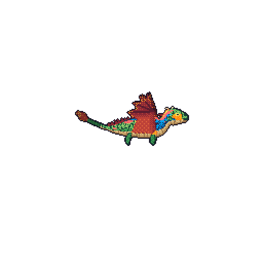

## Hi, I'm Saransh 👋

My coding dragon hatched from my GitHub activity. It grows with my contributions, takes its colours from the languages I use, beats its wings harder on busy days, and breathes fire on the first active day of each week. A new one is drawn every night.

  

Made with [git-dragon](https://github.com/Saransh1220/git-dragon), a fork of [git-koi](https://github.com/yalongwastaken/git-koi) by Anthony Yalong.
